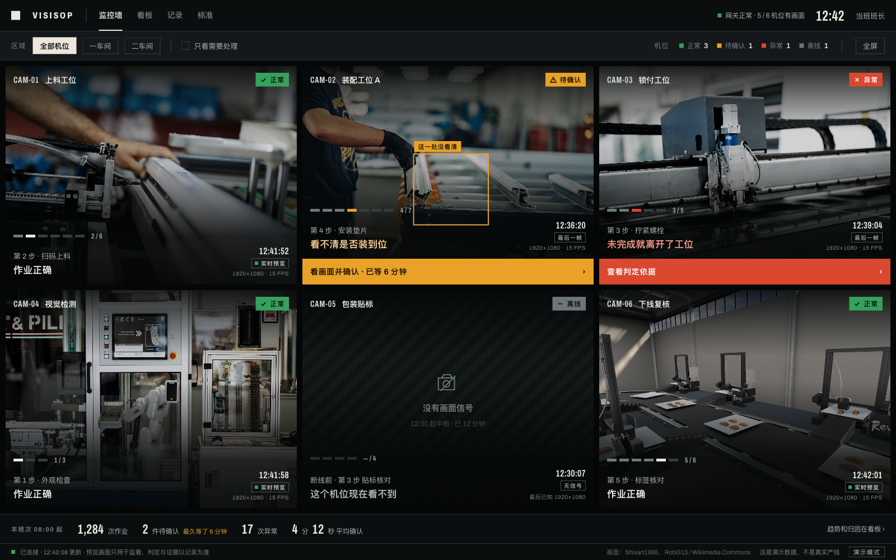
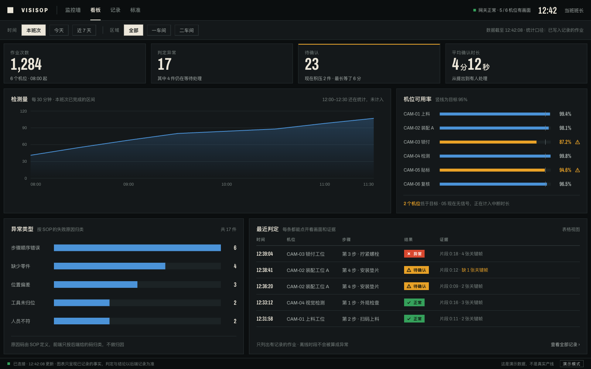

# DESIGN BRIEF — v1.0 / AI-SOP 检测系统

**状态**：v1.0，方向已定稿。取代 v0.1「运行账本 / The Ledger」。
**范围**：产品定位、信息架构、页面地图、验收目标；不包含业务代码。
**依据**：`docs/AI_SOP_Platform_Architecture_v2.0.md` §11.3、§13、§14；`docs/AI_SOP_Architecture_Design_v1.1.md` §9.3、§11.3；`docs/implementation/40-frontend.md`。
**视觉与组件语法**：`DESIGN_SYSTEM.md`。**交互**：`INTERACTION_RULES.md`。**验收**：`VISUAL_QA.md`。
**效果图**：`assets/system-monitor.png`（监控墙）、`assets/system-analytics.png`（看板）。源文件 `.html` 是设计稿，不是生产代码。

## 1. 一句话

VisiSOP 是**通用**的 AI-SOP 检测系统：它看的是"这一步按不按标准做完了"，而不是某一种产品做得好不好。

界面分两层，问题不同：

- **监控墙**回答"现在要不要我动手"——哪个机位是对的、哪个要人确认、哪个没画面。
- **看板**回答"这段时间发生了什么"——量、分布、可用率、处理时长。

追溯（哪一步、哪一帧、哪个版本）在工位详情里完成，不挤占这两层。

## 2. 产品判断

工业视觉产品通常默认做成"视频墙 + KPI 卡片 + 置信度百分比"，并且把某一个客户的产品做成定制主题。VisiSOP 的差异在三点：

1. **抽象层级在产品，不在客户。** 系统检测的是 SOP 步骤是否发生、顺序是否正确、动作是否合规。它不为汽车、食品、电子各做一套 UI；同一套界面靠 SOP 与工位配置适配不同产线。
2. **可追溯，不是画面更多。** 每个结论都能回到具体步骤、事件、规则版本、模型版本和证据。画面是监看手段，不是结论本身。
3. **不知道就说不知道。** 模型不确定、证据缺失、相机断流时，界面不假装知道；`NEEDS_REVIEW` 是正常结果，不是错误弹窗。

## 3. 用户与任务

| 角色 | 主要问题 | 成功画面 | 不关心 |
|---|---|---|---|
| 产线主管 / 操作员 | 现在哪台机位要人？哪一步？等了多久？ | 站在墙前 10 秒内指出要去处理的那一格 | 模型架构、哈希算法 |
| 质量工程师 | 为什么判 `NEEDS_REVIEW`？证据在不在？什么版本？ | 5 分钟内完成"步骤 → 事件 → 证据 → 决定" | 实时画面细节 |
| 复核员 | 我依据什么决定？决定怎么留痕？ | 决定、理由、原始模型输出、证据引用在同一屏 | 产线全景动画 |
| 运维 / 系统管理员 | 相机、推理、平台健康吗？ | 系统事实单独成区，不污染工艺判断 | 工艺步骤细节 |
| 班组长 / 厂级管理 | 这段时间整体怎么样？异常集中在哪？ | 看板上一屏看完量、分布、可用率、积压 | 单帧证据 |

中文是主界面语言；英文 enum 作为机器事实保留，并在需要时给中文对照（映射表见 `DESIGN_SYSTEM.md` §3.3）。不要假设所有用户都读得懂 wire value。

## 4. 四类事实

整个界面的核心约束，也是与普通后台最大的区别。四类事实各有来源，**不得合并成一个"状态"**。

| 事实 | 来源 | 典型内容 | 界面呈现 |
|---|---|---|---|
| 视觉事实 | 视觉事件、模型输出 | 检测框、置信度、模型版本、事件时间 | 原始事实，标注不确定性；不直接等于结论 |
| 工艺事实 | SOP 引擎 / resolver | 步骤状态、`reason_code`、允许的动作、SOP 版本 | 结论与依据；只呈现，不推导 |
| 系统事实 | 相机、Runtime、推理、平台 | 断流、离线、降级、延迟、版本不匹配 | 独立健康区；与工艺告警分开 |
| 证据事实 | 证据管线 | 证据 ID、SHA-256、`PENDING_VERIFY` / `AVAILABLE`、存储位置 | 可用性优先；不可用就明确不可用 |

界面上的直接推论：

- 画面卡上的"待确认"来自执行状态，不来自前端看图。
- 看板的原因分布直接按后端 `reason_code` 归类，前端不做归因。
- 相机离线计入系统健康，不计入工艺异常；离线时段不能被算成 0 次作业。
- 证据缺失写"缺 1 张关键帧"，不用预览帧补位。

## 5. 信息架构

```text
监控墙（默认首页）─────┐
                      ├── 工位详情（单机位：当前执行、步骤、证据、健康）
看板 ─────────────────┘
记录（执行/告警的检索与详情）
标准（SOP 版本、校验、只读 DAG）
系统（相机、绑定、模型、采样、Runtime）
```

**分工纪律**

| 层 | 只回答 | 不回答 |
|---|---|---|
| 监控墙 | 现在哪些机位正常/待确认/异常/离线 | 趋势、分布、归因 |
| 看板 | 一段时间内的量与分布 | 单帧证据、单次判定理由 |
| 工位详情 | 这一格是谁、第几步、证据、健康 | 全厂趋势 |
| 记录 | 某条执行/告警的全部事实 | 实时监看 |

监控墙可以带**少量汇总**（本班次次数、待确认件数、最久等待、异常次数、平均确认时长），因为人站在墙前不该为了这几个数切页；但**不放趋势图**，那是看板的职责。汇总必须标注统计口径（"本班次 08:00 起"），且与看板上的同名数字对得上。

## 6. 页面地图

| 路由 | 页面 | 主要视觉主体 | 主要动作 | 效果图 |
|---|---|---|---|---|
| `/` | 多机位监控墙 | 画面格（每格一台机位） | 发现要处理的格并进入 | `system-monitor.png` |
| `/analytics` | 分析看板 | 时间曲线 | 看量、看分布、点进记录 | `system-analytics.png` |
| `/stations/$stationId` | 工位详情 | 当前执行的步骤与证据 | 确认、查看判定依据 | — |
| `/executions/$executionId` | 执行详情 | 证据查看器 + 四类事实 | 复核、留痕、追溯 | — |
| `/records` | 记录 | 可筛选的执行/告警列表 | 检索、打开详情 | — |
| `/sops` | 标准 | 版本、校验结果、只读 DAG | 校验、发布、看历史 | — |
| `/system` | 系统 | 相机、绑定、模型、采样、Runtime | 查看健康与配置 | — |

执行详情的四类事实组件只写一次：在工位详情里是窄栏，直接访问时是全页。不要在多个地方写两套事实展示。

## 7. 关键屏幕

### 7.1 多机位监控墙（`/`）



- **任务**：站在墙前判断"现在要不要动"，并知道动的理由与等待时长。
- **结构**：56 顶栏（品牌 / 导航 / 连接 / 时钟 / 当班）→ 52 筛选行（区域、只看需要处理、机位计数、全屏）→ 画面墙 → 52 班次条 → 30 状态栏。
- **每格**：画面 + 机位号 + 工位名 + 状态章 → SOP 步骤轨 + 进度 → 当前步骤 + 判定 → 时间 + 画面性质 + 分辨率。需要人处理的格子多一条处置条（动作 + 已等时长）。
- **视觉焦点**：不在装饰，而在**状态差异**——正常的格子安静，待确认/异常/离线各有自己的语言（琥珀处置条 / 红色处置条 / 斜纹无信号）。
- **画面性质必须写明**：`实时预览` / `最后一帧` / `无信号`。阶段 1 无真实预览时显示"预览未接入"，不得用静态图冒充直播。
- **已知限制**：设计稿 6 机位；生产按 4/6/9/16 机位自适应，行列为 `minmax(0,1fr)`。墙屏放大字号，不是等比拉伸。

### 7.2 分析看板（`/analytics`）



- **任务**：回答"这个班次/今天/近 7 天，作业量与异常怎么分布、哪个机位拖后腿、复核积压多重"。
- **结构**：顶栏 → 筛选行（时间、区域、数据截止与统计口径）→ 4 个指标块 → 趋势（占 8 列）+ 机位可用率（4 列）→ 异常原因分布（5 列）+ 最近判定表（7 列）。
- **指标**：作业次数、判定异常、待确认（需人处理时用琥珀顶边）、平均确认时长。
- **图表约束**：单轴、单色相（`--vs-series`）、有 hover、有表格视图。状态色不进图表（见 `DESIGN_SYSTEM.md` §6）。
- **看板不做归因**：原因分布只按后端返回的 `reason_code` 归类，文案写明"前端只按后端给的码归类，不做归因"。
- **时间口径**：未结束的时段不计入，且要写出来（"12:00–12:30 还在统计，未计入"）。

### 7.3 工位详情（`/stations/$stationId`）

- **任务**：站在工位前，回答"当前执行到哪一步、这一步的依据是什么、系统是否健康"。
- **结构**：工位头（机位号、工位名、SOP 版本、状态）→ 当前执行步骤轨 → 活动步骤（展开视觉事实与证据）→ 最近事件 → 系统健康。
- **焦点**：活动步骤与它的证据，不是实时画面。
- **预览失败**：系统健康仍然可见；预览不是证据，失败不影响事实呈现。

## 8. 视觉方向

**感受**：控制室里的仪器，不是数据大屏。冷静、精确、可问责；不制造被监控的压迫感，也不做游戏化的兴奋感。

**隐喻**：机架、监视器、SOP 步骤轨。图形只来自系统自身——画面、进度段、判定章、坐标标签。

- **材质**：石墨机身 + 骨白油墨 + 画面填充；无圆角、无卡片阴影、无渐变；分层靠 1px 线、底色与留白。
- **字体**：Archivo 变体（自托管）。窄体（`wdth 62%`）给数字、ID、时间戳、大标题；常规宽度给中文正文。中文回退 PingFang SC / Noto Sans CJK SC。
- **颜色**：一色一义。绿=正常/完成/健康；琥珀=待确认/等待人/低于目标；红=工艺异常；灰=离线/不可用；蓝=唯一的数据系列；骨白与石墨承担结构与文字。
- **画面**：真实照片统一处理（去饱和、压暗、双层渐变），与界面形成"被监看的现场"和"正在读的仪器"的对比。不得用线稿、插画、占位图冒充相机帧。
- **动效**：只在状态变化时出现，120–180ms；没有环境动画、数字滚动、呼吸灯。
- **品牌表达**：方角机身、SOP 步骤轨、状态章（图标+文字）、处置条、窄体时间戳、班次条、仪器式状态栏。字标与结构不用信号色。

**借鉴说明**：方向探索期参考了 `assets/design.png` 的构图——每格画面上带 SOP 步骤进度、机位卡角信息、顶部筛选与整体暗场。借用的是"把步骤进度嵌进画面卡"这个结构性想法；未采用它的通过率环图、渐变发光折线、侧边栏和蓝色卡片网格。理由：通过率不是本系统的合法指标，图表必须单色相可访问。

完整 token 与组件语法见 `DESIGN_SYSTEM.md`。

## 9. 成功标准

一个第一次使用的人，在不解释的情况下，能：

1. **10 秒**内在墙上指出"现在要处理的是哪一格"，并说出为什么、等了多久。
2. **30 秒**内说清本班次作业量、待确认件数、异常次数。
3. **1 分钟**内从看板下钻到具体那条记录，并看到证据可用性。

以及在 5 分钟内完成一次追溯：从 `NEEDS_REVIEW` 找到步骤、事件、证据、模型/规则版本，并记录决定。

不把"更漂亮""更多 KPI""更像大屏"当作成功。

## 10. 明确不做

- 针对单一行业/产品的定制主题与专属插画。
- 通过率、合格率、效率分、综合评分——这些不是本系统能给出的量。
- 把置信度当合格率，把预览帧当证据。
- 视频墙式的装饰性拼贴、3D 数字孪生、产线全景动画。
- 通用 AI 后台的卡片网格、渐变 hero、玻璃拟态、发光边框。
- 图形化 SOP 编辑器（阶段 1 只做校验、发布、只读 DAG）。
- 前端推导 SOP 结论，或用视觉事件直接改前端状态。
- 生产环境里的假工位名、假哈希、假指标、假 ROI（演示数据必须标注"演示模式"）。
- 真实相机接入、DeepStream、预览流（阶段 1 边界）。

## 11. 待确认

| # | 问题 | 当前假设 | 何时必须确认 |
|---|---|---|---|
| Q1 | 主要显示设备 | 桌面 1440–1600 为主，1920 墙屏为次 | 首个页面实现前 |
| Q2 | 首个演示的主要用户 | 产线主管（墙优先） | 首个页面实现前 |
| Q3 | 演示模式 | 历史回放 + 模拟事件，界面标"演示模式" | 首个页面实现前 |
| Q4 | 机位数量 | 设计稿 6；生产按 4/6/9/16 自适应 | 监控墙实现前 |
| Q5 | 浅色主题 | 不做。控制室暗场是设计前提 | 已定 |
| Q6 | 语言 | 中文主界面，英文 wire value | 文案冻结前 |
| Q7 | 字体托管 | 自托管 WOFF2（SIL OFL），离线可用 | 首次上线前 |
| Q8 | 证据查看器是否需下载/标注 | 阶段 1 只读查看 | 契约确定后 |
| Q9 | 图表库 | 未定；优先轻量、可单色相配置、可表格视图 | 看板实现前 |
| Q10 | 预览能力上线时间 | 阶段 2。此前一律显示"预览未接入" | 阶段 2 启动前 |

效果图是 1600×1000 的桌面设计稿；生产按 `DESIGN_SYSTEM.md` §4.2 的桌面/墙屏/窄屏规则适配，不是等比缩放。
